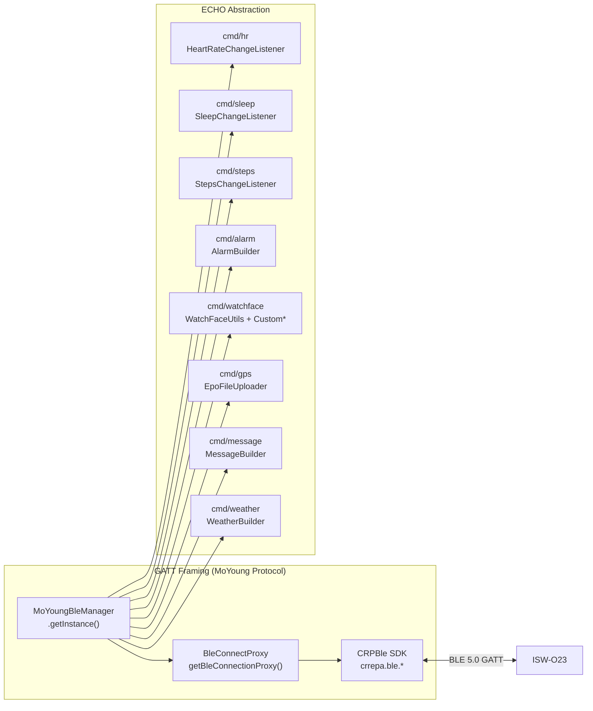
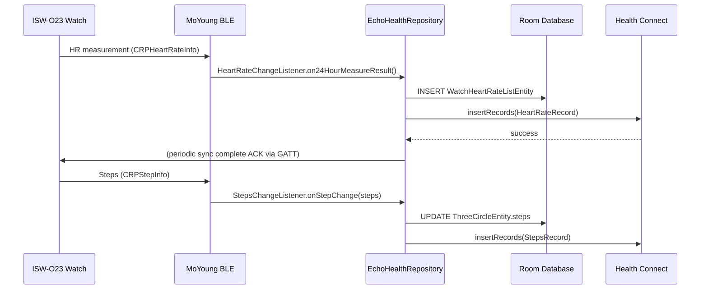
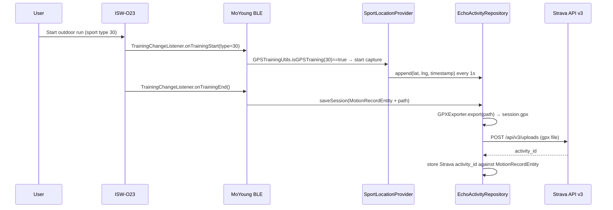
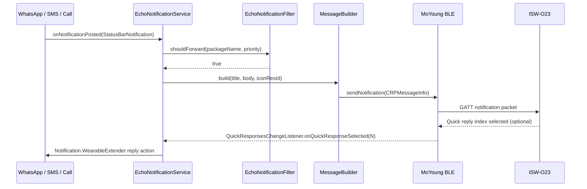
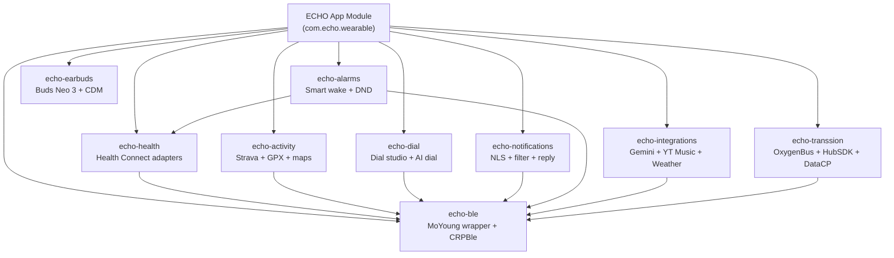

# ECHO — System Architecture

> **Stack:** itel ISW-O23 Storm ↔ itel P55 (Transsion OS, Android 14) ↔ itel Buds Neo 3

---

## 1. High-Level System Diagram

```mermaid
flowchart TD
    subgraph WATCH["ISW-O23 Storm (MoYoung/Sifli SF32LBxx)"]
        W_SENSOR["Sensors\nHR · SpO₂ · Temp · Accel"]
        W_GPS["GPS Assist\n(EPO via phone)"]
        W_UI["Watch UI\nDials · Alarms · Notifications"]
        W_BLE["BLE 5.0 GATT\nMoYoung Protocol"]
    end

    subgraph PHONE["itel P55 — Transsion OS / Android 14"]
        subgraph ECHO["ECHO App (com.echo.wearable)"]
            BLE_LAYER["BLE Transport\nMoYoungBleManager"]
            HEALTH_REPO["EchoHealthRepository\n(Room DB)"]
            ACTIVITY_REPO["EchoActivityRepository\n(Room DB + GPX)"]
            NOTIF_SVC["EchoNotificationService\nNotificationListenerService"]
            ALARM_MGR["EchoAlarmManager\nSmart Wake Engine"]
            DIAL_STUDIO["ECHO Dial Studio\nCustomWatchFaceProxy"]
            MEDIA_CTRL["EchoMediaController\nMediaSessionManager"]
            INTENT_BRIDGE["EchoIntentBridge\nGemini · Camera · Find"]
            EARBUDS_MGR["EchoEarbudsManager\nCompanionDeviceManager"]
            WEATHER_SVC["EchoWeatherService\nOpenWeatherMap API"]
        end

        subgraph TRANSSION["Transsion OS Services"]
            OXYGENBUS["OxygenBus 1.5.136\nIPC Event Bus"]
            HUB_SDK["HubSDK\nSystem Settings Bridge"]
            DATA_CP["DataContentProvider\ncom.health.provider.ifit"]
        end

        subgraph ANDROID_APIS["Android 14 APIs"]
            HEALTH_CONN["Health Connect\nandroidx.health.connect"]
            TELECOM["TelecomManager\nCall Control"]
            AUDIO["AudioManager\nSTREAM_MUSIC"]
            NLS["NotificationListenerService\nSystem Notifications"]
            CDM["CompanionDeviceManager\nDevice Association"]
        end
    end

    subgraph CLOUD["Cloud / External APIs"]
        STRAVA["Strava API v3\nOAuth 2.0 + Activities"]
        OWM["OpenWeatherMap\nAPI v3 One Call"]
        GEMINI_API["Gemini API\nAI Dial Generation"]
        YT_MUSIC["YouTube Music\nMediaSession"]
    end

    subgraph BUDS["itel Buds Neo 3"]
        BUDS_A2DP["A2DP Audio Profile"]
        BUDS_HFP["HFP Call Profile"]
        BUDS_GATT["GATT Battery 0x180F"]
    end

    W_SENSOR --> W_BLE
    W_UI --> W_BLE
    W_BLE <-->|BLE 5.0| BLE_LAYER

    BLE_LAYER --> HEALTH_REPO
    BLE_LAYER --> ACTIVITY_REPO
    BLE_LAYER --> ALARM_MGR
    BLE_LAYER <--> DIAL_STUDIO
    BLE_LAYER <--> NOTIF_SVC
    BLE_LAYER <--> MEDIA_CTRL
    BLE_LAYER --> INTENT_BRIDGE

    HEALTH_REPO --> HEALTH_CONN
    ACTIVITY_REPO --> STRAVA
    WEATHER_SVC --> OWM
    WEATHER_SVC --> BLE_LAYER
    DIAL_STUDIO --> GEMINI_API
    MEDIA_CTRL --> AUDIO
    MEDIA_CTRL --> YT_MUSIC
    INTENT_BRIDGE --> TELECOM
    EARBUDS_MGR --> CDM

    ECHO --> OXYGENBUS
    ECHO --> HUB_SDK
    ECHO --> DATA_CP

    EARBUDS_MGR <-->|BT Classic| BUDS_A2DP
    EARBUDS_MGR <-->|BT Classic| BUDS_HFP
    EARBUDS_MGR <-->|BLE| BUDS_GATT
```



---

## 2. BLE Communication Layer

The BLE transport is fully inherited from iPulse. ECHO adds an abstraction layer above it.



---

## 3. Data Flow — Health Metrics



---

## 4. Data Flow — Activity Tracking (Strava)



---

## 5. Data Flow — Notification Pipeline



---

## 6. Module Dependency Map



---

## 7. Package Structure

```
com.echo.wearable/
├── app/
│   ├── MainActivity.kt                   # Nav host
│   ├── EchoApplication.kt               # App init, OxygenBus register
│   └── di/                              # Hilt modules
├── ble/
│   ├── EchoBleManager.kt               # Wraps MoYoungBleManager
│   ├── EchoConnectionState.kt          # BLE state enum
│   └── protocol/                       # MoYoung cmd adapters
├── health/
│   ├── EchoHealthRepository.kt         # Health data aggregator
│   ├── connect/
│   │   ├── HealthConnectWriter.kt      # Health Connect inserts
│   │   └── HealthConnectReader.kt      # Health Connect queries
│   └── model/                          # Domain models (EchoHrReading, etc.)
├── activity/
│   ├── EchoActivityRepository.kt       # Sport session manager
│   ├── strava/
│   │   ├── StravaAuthManager.kt        # OAuth 2.0
│   │   └── StravaUploader.kt           # API v3 upload
│   ├── gps/
│   │   ├── SportLocationProvider.kt    # (retained from iPulse)
│   │   └── GpxExporter.kt             # GPX 1.1 generator
│   └── ui/                            # Activity list, map, lap analysis
├── dial/
│   ├── EchoDialRepository.kt           # Dial state manager
│   ├── studio/
│   │   ├── DialStudioViewModel.kt      # Studio state
│   │   └── DialCanvas.kt              # Drag-drop complication editor
│   ├── ai/
│   │   └── GeminiDialGenerator.kt     # Gemini Vision API
│   └── theme/
│       └── DynamicThemeEngine.kt      # Auto-switch by context
├── notifications/
│   ├── EchoNotificationService.kt      # NotificationListenerService
│   ├── EchoNotificationFilter.kt       # Per-app filter + mute
│   └── reply/
│       └── NotificationReply.kt       # RemoteInput quick reply
├── alarms/
│   ├── EchoAlarmManager.kt            # Alarm CRUD + sync
│   ├── SmartWakeEngine.kt             # Sleep stage analyser
│   └── DndScheduler.kt               # DND time-window manager
├── earbuds/
│   ├── EchoEarbudsManager.kt          # CompanionDeviceManager
│   ├── BudsConnectionMonitor.kt       # A2DP/HFP state
│   └── BatteryGattClient.kt           # 0x180F battery read
├── integrations/
│   ├── media/
│   │   └── EchoMediaController.kt     # MediaSessionManager
│   ├── weather/
│   │   └── EchoWeatherService.kt      # OpenWeatherMap + WeatherBuilder
│   ├── gemini/
│   │   └── EchoIntentBridge.kt        # ACTION_ASSIST trigger
│   └── whatsapp/
│       └── WhatsAppNotificationParser.kt
└── transsion/
    ├── OxygenBusClient.kt             # OxygenBus IPC subscriber
    ├── HubSdkBridge.kt               # System settings integration
    └── EchoDataContentProvider.kt    # Extends DataContentProvider
```

---

## 8. Key Design Principles

| Principle | Implementation |
|---|---|
| **Thin BLE layer** | All GATT framing stays in `echo-ble`; feature modules never touch raw BLE |
| **Repository pattern** | Each domain has one `EchoXxxRepository` as single source of truth |
| **Health Connect first** | All biometric writes go to Health Connect; local Room DB is a cache |
| **Offline first** | All Strava, weather, Gemini calls are queued via `WorkManager`; app works without internet |
| **Feature flags** | Per-feature runtime toggle using `EchoFeatureFlags` (backed by Transsion `HubSDK`) |
| **No signature permissions** | ECHO uses only standard Android + OxygenBus IPC; no Transsion signature dependencies |

---

*Architecture derived from decompiled `com.transsion.healthifit 5.9.1.17` codebase.*
*All module boundaries designed around the existing MoYoung SDK package structure.*
